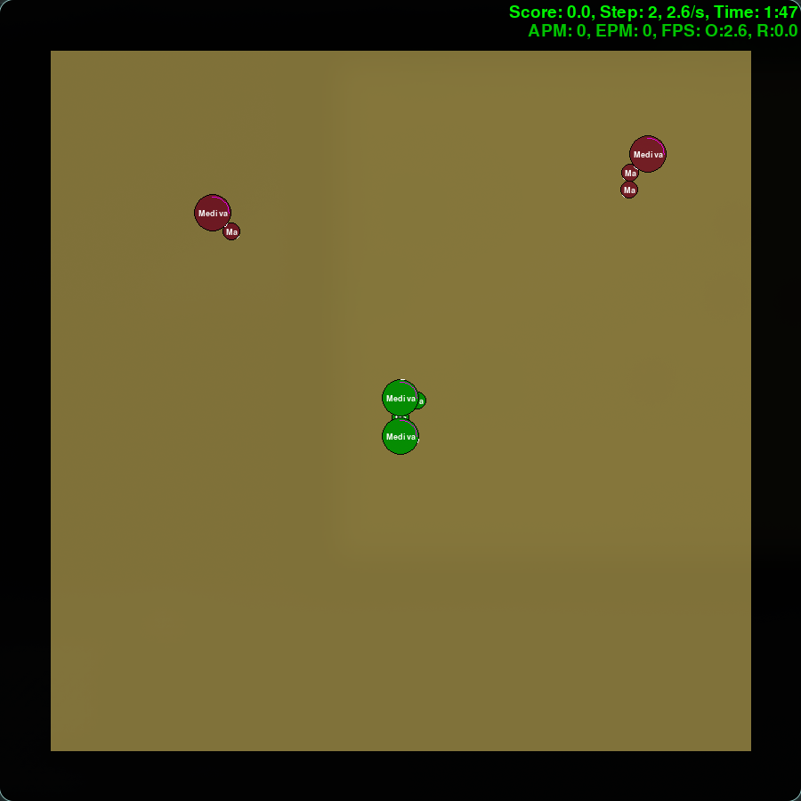
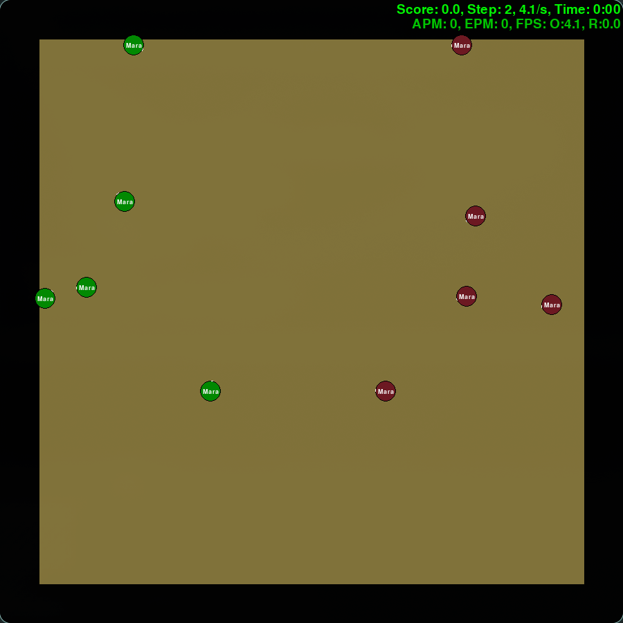

# SINT
Soldier INTelligence — simple AI architectures and algorithms testing for SMACv2

[SMACv2](https://github.com/oxwhirl/smacv2) is a benchmark for research in the field of cooperative multi-agent reinforcement learning. It focuses on decentralised micromanagement scenarios in [StarCraft II](https://starcraft2.blizzard.com/en-gb/), rather than the full game. It makes use of Blizzard’s StarCraft II Machine Learning API as well as Deepmind’s PySC2.

Trained models are NOT given, please run `train.py` first before using `watch.py`. You can `watch.py` as soon as you get a first model from the training (every ~100k steps).


# Windows set-up 🪟
Download [Battle.net](https://www.blizzard.com), then download Starcraft 2. Once you are finished, start the game once and close it. Download SMACv2 maps via powershell:
```powershell
$dst = "C:\Program Files (x86)\StarCraft II\Maps\SMAC_Maps"
New-Item -ItemType Directory -Force $dst | Out-Null
Invoke-WebRequest "https://github.com/oxwhirl/smacv2/releases/download/maps/SMAC_Maps.zip" -OutFile "$env:TEMP\SMAC_Maps.zip"
Expand-Archive "$env:TEMP\SMAC_Maps.zip" -DestinationPath $dst -Force
Test-Path "$dst\32x32_flat.SC2Map"
```

we use the following code to have smooth render.
```python
from pysc2.lib import remote_controller as rc
_step = rc.RemoteController.step
rc.RemoteController.step = lambda self, count=1: [(_step(self, 1), time.sleep(1 / 22.4)) for _ in range(count)]
```

# The scenarios

SMACv2 propose by default 3 customizable scenarios, each are in `scenarios/` and each of them is a 5v5 (configurable) same race scenario. Each scenario can be a **surround** (allied unit spawn in the middle of the map and enemy units circle them) or **reflect** (allied unit spawn randomly and enemy units reflect their position).

| Surround                                       | Reflect                                      |
|:----------------------------------------------:|:--------------------------------------------:|
|  |   |

**Small note on Terran:** I will not test Terran (for now). Terran teams can include medivacs, a unit that heal an ally instead of attacking an enemy. SMACv2 indexes these heal actions by the target’s absolute agent ID, while each agent’s observation lists its allies in ID order skipping itself and does not include its own ID. A medivac cannot know which action heals which ally (the mapping shifts by one depending on its own unknown ID).


# Results
The following results are organized as it follows, a terran section, a protoss Section and a zerg section, covering every scenario. This is useful to measure how "hard" a specific race can be to play. Models are grouped into 3 categories, *Base* with around ~75k parameters in the actor, *Mini* and *Large* with respectively ~45k and ~155k parameters in their actor. Results are tested over 3200 episode which on average give ~$\pm$ 1.7%, averaged over 3 seeds, it is also given their variance.

## Protoss

### Table

| Model-Algorithms/Size   | Mini | Base                        | Large                              |
|-------------------------|------|-----------------------------|------------------------------------|
| Shared MLP IPPO         |      | 🟨 $54.18_{2.99}$%        |                                    |
| Separated MLP IPPO      |      | 🟩 $65.42_{1.21}$%        |                                    |
| Shared Transformer IPPO |      | 🟩 $72.83_{0.7}$%         |                                    |

### Some graphs

| Return/episode                                             | Winrate                                                      |
|:-----------------------------------------------------------:|:------------------------------------------------------------:|
|  |   |

# References
This project uses the SMACv2 benchmark [1].

[1] B. Ellis, J. Cook, S. Moalla, M. Samvelyan, M. Sun, A. Mahajan, J. N. Foerster and S. Whiteson,
"SMACv2: An Improved Benchmark for Cooperative Multi-Agent Reinforcement Learning",
*NeurIPS 2023 Datasets and Benchmarks Track*. https://openreview.net/forum?id=5OjLGiJW3u

```bibtex
@inproceedings{ellis2023smacv2,
    title={{SMAC}v2: An Improved Benchmark for Cooperative Multi-Agent Reinforcement Learning},
    author={Benjamin Ellis and Jonathan Cook and Skander Moalla and Mikayel Samvelyan and Mingfei Sun and Anuj Mahajan and Jakob Nicolaus Foerster and Shimon Whiteson},
    booktitle={Thirty-seventh Conference on Neural Information Processing Systems Datasets and Benchmarks Track},
    year={2023},
    url={https://openreview.net/forum?id=5OjLGiJW3u}
}
```