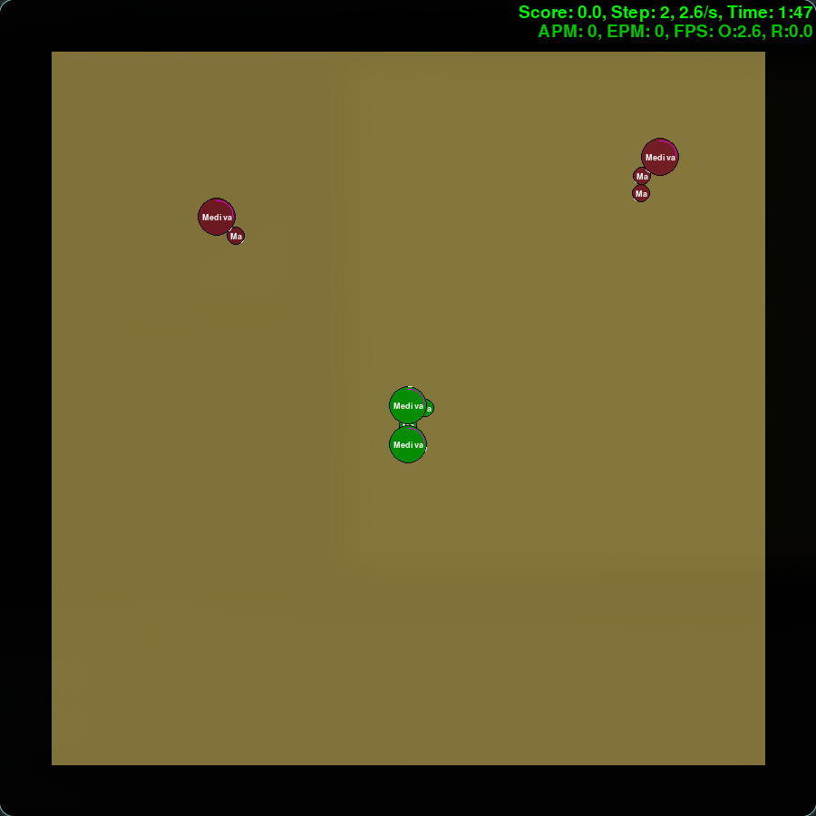
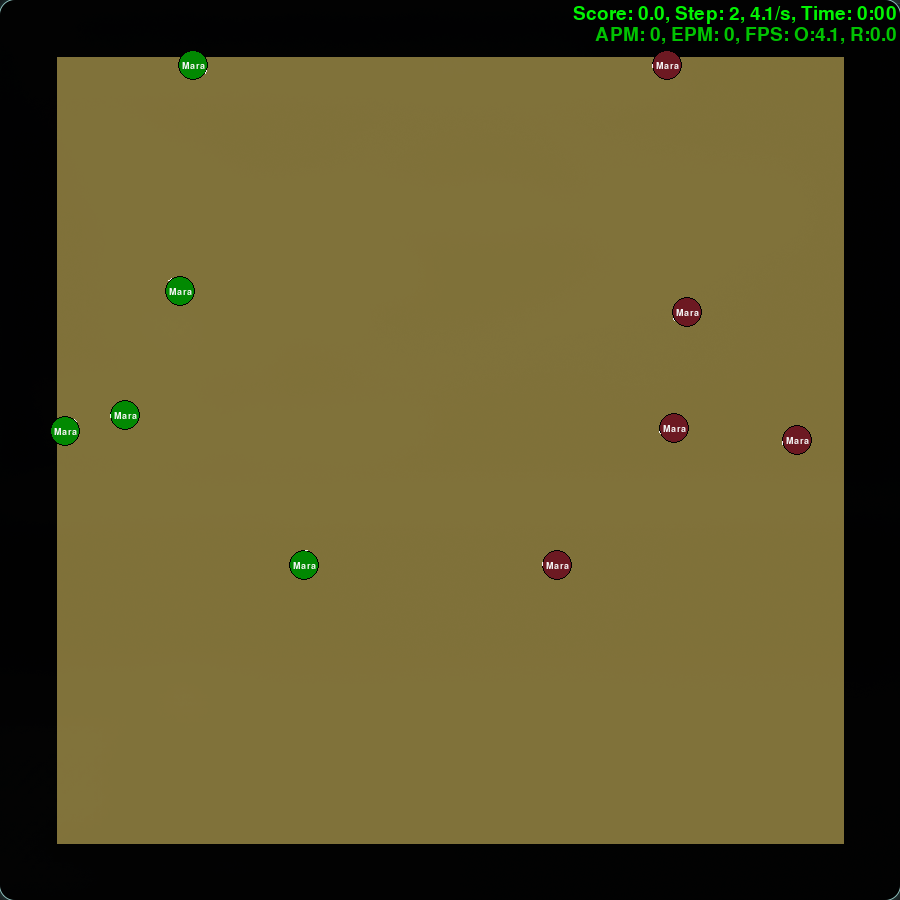

# SINT 2.0.5
Soldier INTelligence — simple AI architectures and algorithms testing for SMACv2

[SMACv2](https://github.com/oxwhirl/smacv2) is a benchmark for research in the field of cooperative multi-agent reinforcement learning. It focuses on decentralised micromanagement scenarios in [StarCraft II](https://starcraft2.blizzard.com/en-gb/), rather than the full game. It makes use of Blizzard’s StarCraft II Machine Learning API as well as Deepmind’s PySC2.

Trained models are NOT given, please run `train.py` first before using `watch.py`. You can `watch.py` as soon as you get a first model from the training (every ~100k steps).


## Instruction for reading

- I. Some part of the code were written by AI, either to prevent the writer against error, because the code was redundant or because an AI had a good idea to implement. Such passage, are enclosed between two comment '# ...-----Z-----...'.
- II. The terminology has been the object of a meticulous work. I have made every effort to never deviate from standard terminology without very serious reasons.
- III. I sought to use rigorous and correct syntax without sacrificing the simplicity of the code. As much as possible, I have pointed out instances of notation abuse — without which any code risks becoming pedantic, slow, or even unreadable.
- IV. programs where agents are trained, tested, etc... Are copied and adjusted from `random_agents.py`


# Set-up (Linux🐧, tested on Arch)
If you're not on linux, please refer to [SMACv2 README](https://github.com/oxwhirl/smacv2/blob/main/README.md)

## How to install SMACv2
In order to make SMACv2 work you need to first install and set-up Blizzard's StarcraftII Headless engine:
```bash
cd ~
wget http://blzdistsc2-a.akamaihd.net/Linux/SC2.4.10.zip
unzip -P iagreetotheeula SC2.4.10.zip
rm SC2.4.10.zip
```
The game is then installed in `~/StarCraftII/`.
You then need SMAC and SMACv2 maps (both are in SMACv2 repo):
```bash
mkdir -p ~/StarCraftII/Maps/SMAC_Maps
git clone --depth 1 https://github.com/oxwhirl/smacv2.git /tmp/smacv2
cp /tmp/smacv2/smacv2/env/starcraft2/maps/SMAC_Maps/*.SC2Map ~/StarCraftII/Maps/SMAC_Maps/
rm -rf /tmp/smacv2
```
Depending on your desktop environment you may face issues, as I am on Hyprland, I added these two lines for the render:
```py
import os
os.environ["SDL_VIDEODRIVER"] = "x11"
```
running this also works:
```bash
SDL_VIDEODRIVER=x11 python random_agents.py
```

## Enable 3D
The SC2 Linux build ships an old `libstdc++` that prevents Mesa from loading. Disable it or it will crash:
```bash
mv ~/StarCraftII/Libs/libstdc++.so.6 ~/StarCraftII/Libs/libstdc++.so.6.bak
```

## Set-up the python environment
You will need [uv](https://docs.astral.sh/uv/).

```bash
git clone https://github.com/Mxncrou/SINT.git
cd SINT
uv sync
source .venv/bin/activate
```
Once this is done, please use the testing script to ensure you got everything right on SMACv2 installation:
```bash
python random_agents.py
```

You can then edit `settings.json` to customize your use.


# The scenarios

SMACv2 propose by default 3 customizable scenarios, each are in `scenarios/` and each of them is a 5v5 (configurable) same race scenario. Each scenario can be a **surround** (allied unit spawn in the middle of the map and enemy units circle them) or **reflect** (allied unit spawn randomly and enemy units reflect their position).

| Surrounded                                    | Reflect                                    |
|:---------------------------------------------:|:------------------------------------------:|
|  |  |


# Results
The following results are organized as it follows, a terran section, a protoss Section and a zerg section, covering every scenario. This is useful to measure how "hard" a specific race can be to play. Models are grouped into 3 categories, *Base* with around ~75k parameters in the actor, *Mini* and *Large* with respectively ~45k and ~155k parameters in their actor. Results come from `evaluate()` which run 32 episodes with a greedy action selection. In each cell, the winrate over 32 games is displayed as long with a 95% Wilson confidence interval.

## Protoss

| Model-Algorithms/Size | Mini | Base                        | Large                              |
|-----------------------|------|-----------------------------|------------------------------------|
| Shared MLP IPPO       |      |                             |                                    |


# References
This project uses the SMACv2 benchmark [1].

[1] B. Ellis, J. Cook, S. Moalla, M. Samvelyan, M. Sun, A. Mahajan, J. N. Foerster and S. Whiteson,
"SMACv2: An Improved Benchmark for Cooperative Multi-Agent Reinforcement Learning",
*NeurIPS 2023 Datasets and Benchmarks Track*. https://openreview.net/forum?id=5OjLGiJW3u

```bibtex
@inproceedings{ellis2023smacv2,
    title={{SMAC}v2: An Improved Benchmark for Cooperative Multi-Agent Reinforcement Learning},
    author={Benjamin Ellis and Jonathan Cook and Skander Moalla and Mikayel Samvelyan and Mingfei Sun and Anuj Mahajan and Jakob Nicolaus Foerster and Shimon Whiteson},
    booktitle={Thirty-seventh Conference on Neural Information Processing Systems Datasets and Benchmarks Track},
    year={2023},
    url={https://openreview.net/forum?id=5OjLGiJW3u}
}
```